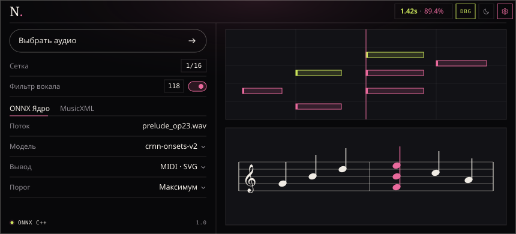
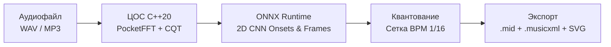

# NotsAI


**NotsAI** — высокопроизводительный нейросетевой комплекс автоматической транскрипции музыки, который за секунды преобразует аудиофайлы (`WAV`, `MP3`, `FLAC`) в символьный формат MIDI (`.mid`) и векторную нотную партитуру (`MusicXML`, `SVG`). Инструмент решает проблему многочасового ручного подбора партий на слух и устраняет ошибки классических частотных детекторов, путающих акустические обертоны с реальными аккордами.

---

## Визуализация



Пример работы консольного движка на C++20:

```text
[NotsAI 1.0 · ONNX Runtime C++20 · AVX2]
├─ Входной поток : prelude_op23.wav (44.1 kHz, 16-bit, Stereo, 03:12)
├─ Модуль ЦОС    : CQT-спектрограмма (88 полутонов, PocketFFT) ...... 0.42s
├─ Инференс ИИ   : 2D CNN / CRNN (Onsets & Frames) .................. 0.89s
├─ Постобработка : BPM 118.0 · Квантование 1/16 · Очистка ОЗУ ....... 0.11s
└─ Результат     : prelude_op23.mid (1420 нот) · prelude_op23.musicxml (1.42s)
```

---

## Основные возможности (Features)

* **Полифоническое распознавание (Onsets & Frames):** раздельное детектирование момента атаки струны (`Onset`) и длительности удержания ноты (`Frame`) позволяет распознавать сложные аккорды до 10 голосов одновременно.
* **Подавление паразитных гармоник:** сверточная сеть над логарифмической спектрограммой постоянной добротности (`CQT`, 88 полутонов) отличает обертоны от нажатых клавиш.
* **Нативное расчетное ядро на C++20:** инференс через `ONNX Runtime C++ API` и быстрое преобразование Фурье (`PocketFFT`) обеспечивают обработку 3-минутной записи менее чем за 2–5 секунд на обычном ЦП.
* **Фильтрация вокальной партии:** опциональное предварительное подавление голоса для выделения чистого инструментала.
* **Ритмическое квантование:** автоопределение темпа (BPM) и выравнивание нот по долям такта (`1/4`, `1/8`, `1/16`).
* **Векторный нотный стан:** рендеринг партитуры в `SVG` и `MusicXML 4.0` через `OpenSheetMusicDisplay`.
* **Регламент Zero-Retention:** полностью бессерверная (`Stateless`) обработка в оперативной памяти без сохранения пользовательских треков на диск и без СУБД.

---

## Установка (Installation)

```bash
# 1. Клонирование репозитория
git clone https://github.com/dmitry-adrov/NotsAI.git
cd NotsAI

# 2. Установка Python-зависимостей (для обучения модели и локального веб-сервера)
pip install -r requirements.txt

# 3. Сборка расчетного C++20 ядра через CMake
mkdir build && cd build
cmake .. -DCMAKE_BUILD_TYPE=Release
cmake --build . --config Release
```

---

## Использование (Usage)

### 1. Запуск веб-интерфейса

```bash
python app/server.py --port 8080 --model models/notsai_crnn.onnx
```

### 2. Запуск CLI-ядра напрямую

```bash
./build/notsai_cli -i ./samples/track.wav -o ./out/track.mid -x ./out/track.musicxml -q 16 -v
```

### Основные параметры и флаги

| Флаг | Сокращение | По умолчанию | Описание |
| :--- | :---: | :---: | :--- |
| `--input <path>` | `-i` | *Обязательный* | Путь к входному аудиофайлу (`WAV`, `MP3`, `FLAC`, `OGG`) |
| `--output <path>` | `-o` | `output.mid` | Путь для сохранения выходного файла стандарта MIDI 1.0 |
| `--xml <path>` | `-x` | `None` | Экспорт партитуры в формат `MusicXML 4.0` |
| `--quantize <grid>` | `-q` | `16` | Сетка квантования длительностей (`4`, `8`, `16`, `32`) |
| `--remove-vocals` | `-v` | `false` | Включить предварительное подавление вокала |
| `--threshold <val>` | `-t` | `0.55` | Порог чувствительности детектора атак (от `0.10` до `0.95`) |

---

## Структура проекта (Project Structure)



```text
NotsAI/
├── assets/
│   └── preview.svg          # Скриншот интерфейса
├── include/                 # Заголовочные файлы ядра C++20
│   ├── cqt.hpp              # Спектрограмма постоянной добротности
│   ├── onnx_runner.hpp      # Инференс ONNX Runtime C++ API
│   └── quantizer.hpp        # Ритмическое квантование и экспорт MIDI
├── src/                     # Исходный код C++20
├── ml/                      # Обучение модели (PyTorch) и экспорт в .onnx
├── web/                     # Веб-интерфейс в дизайн-системе Obsidian/Rosewater
├── CMakeLists.txt           # Сборка C++ проекта
├── requirements.txt         # Зависимости Python
├── LICENSE                  # Лицензия MIT
└── README.md                # Документация проекта
```

---

## Разработка и вклад (Contributing)

1. **Сообщить об ошибке (Issue):** создайте обращение во вкладке [Issues](../../issues), указав версию ОС, команду запуска и формат входного аудиофайла.
2. **Отправить Pull Request:**
   * Сделайте Fork репозитория и создайте ветку (`git checkout -b feat/simd-cqt`).
   * Проверьте прохождение тестов (`ctest --test-dir build`).
   * Отправьте Pull Request в ветку `main`.

---

## Лицензия (License)

Проект распространяется под лицензией **MIT**. Подробности в файле [LICENSE](./LICENSE).
